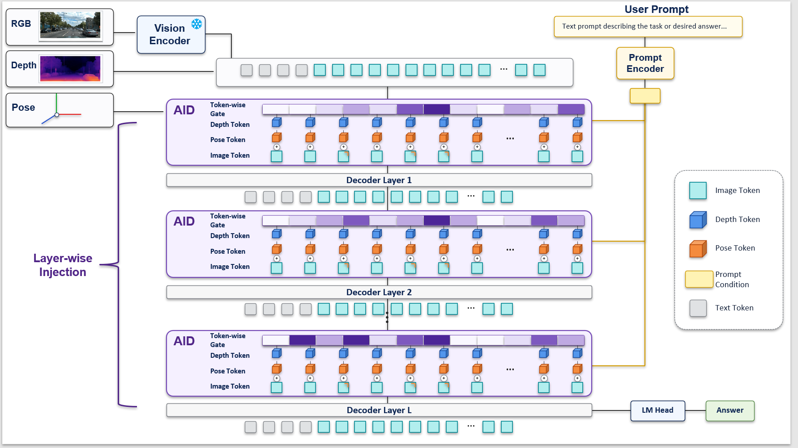

# FlowSketch

English | [简体中文](README.md)

FlowSketch is an installation-free browser editor for flowcharts and publication figures. It is designed for flow diagrams, model architecture figures, token matrices, annotated diagrams, and technical illustrations containing images. Projects are stored in a human-readable JSON format.

## Key Features

- Basic shapes, block arrows, braces, text, LaTeX formulas, notes, and images
- Group management with create, join, leave, ungroup, and layer-ordered automatic stacking
- Straight, auto/manual orthogonal, and smoothly controlled curved connectors with five independently selectable marker styles at each end
- Token matrices, 3D stacks, image-pooling colors, and RGBA/color/grayscale channels
- Multiple selection, alignment, even distribution, layer ordering, rotation, and eight-direction resizing
- 120 built-in color themes that can be applied to the entire drawing or only the current selection
- Undo, redo, copy, paste, a canvas context menu, and common keyboard shortcuts
- Native PPTX, SVG, PNG, and JSON export
- Multi-file browser storage, drag-and-drop import, and autosave

## Getting Started

The project has no build step. Open `index.html` directly in a modern desktop browser.

1. Choose a shape, text, formula, connector, token matrix, note, or image from the left sidebar. Use a dashed rectangle when a visible boundary is needed.
2. Move, resize, or rotate elements on the canvas, then edit dimensions, colors, text, and styles in the right sidebar.
3. Drag a connector endpoint to reveal the four-way shape anchors. Add detours and drag green segment handles on orthogonal routes, or drag the orange handles on curves.
4. Use **“导出” (Export)** in the top bar to generate native PPTX, SVG, or PNG. Use **JSON** to inspect or download the current project data.

PPTX export preserves the custom canvas size and layer order. Basic shapes, text, token cells, straight/orthogonal segments, and curves remain editable PowerPoint shapes; images use picture objects, while LaTeX formulas use transparent PNGs to preserve their appearance. PowerPoint has no equivalent native model for four-corner gradients, so those shapes use their center interpolated color.

Projects are automatically saved to IndexedDB in the current browser profile. Clearing browser site data removes these local files, so export backups of important work regularly.

## Browser AI Assistant

Use the top-right **AI** panel to configure an OpenAI-compatible Chat Completions endpoint, key, and model. Settings stay in the current browser; messages and canvas data go directly to the configured API, without passing through the webpage server.

Enable **Model supports image input** to send a current canvas screenshot at the start of each request (blank canvases use a text description instead) and after each successful edit. The model can inspect alignment, overlaps, text, and connectors, then make further corrections. Both JSON and tools modes support this feedback loop; tools mode also exposes a read-only `view_canvas` tool. Screenshots contain only the canvas, with grids and editing handles hidden, and exclude chat, settings, and keys. They are observations, not image assets added to the drawing.

Each user message allows up to four screenshot attempts and eight model calls, sharing the configured total timeout and Stop control. Failed captures and limits are reported without discarding applied edits, which remain undoable. Only the latest canvas screenshot remains in model context; uploaded reference images follow the history window. Screenshots live in page memory and are not separately persisted in browser storage.

Click reference images, canvas screenshots, or pending attachments to preview them at fit, original size, or 200%. Use **Select region** to drag a rectangle or enter pixel coordinates, then queue the crop; cropping a pending attachment replaces its original. Select canvas elements and click **Send elements to chat** above the composer, then describe the adjustment. Removable target tags send the actual element IDs and survive canvas deselection. Automatic screenshots use current target bounds with surrounding padding; previous whole-canvas and historical reference pixels are omitted, while structure and trusted asset IDs remain available. Tools can inspect canvas pixels via `view_canvas({region:{x,y,w,h}})` or source-reference pixels via `view_reference({assetId,region})`; omit region for a full image. Region offsets and dimensions accompany every crop. Visual verification applies only to the actual region shown. A persistent animated status shows thinking, drawing, and refinement until the request ends.

## Formula Editing

Choose **Formula** in the left sidebar to insert a LaTeX formula. The editor provides two workflows:

- **Visual editing**: work directly in the typeset formula, click a dotted placeholder to fill it, and insert fractions, roots, scripts, integrals, matrices, cases, or other structures at any placeholder or cursor position. Structures can be nested without limit.
- **Categorized formula library**: browse structures, basic math, Greek letters, relations, operators, sets and logic, arrows, and calculus, or open the complete numeric, symbol, alphabetic, and Greek virtual keyboard.
- **LaTeX source**: type any KaTeX-supported LaTeX directly and switch back and forth with the visual editor.

The editor keeps LaTeX synchronized and reports syntax errors. Double-click a formula on the canvas to edit it again, or use the properties panel to change its size, color, rotation, and display mode. Formula data is stored in project JSON and participates in SVG, PNG, and clipboard-image export.

## Files and Import

Click **“文件” (Files)** in the upper-right corner to open the file list. Creating or importing a project always creates an independent file and never overwrites an existing one. Continuing to edit the active file updates only that file.

- Files are sorted by modification time, newest first.
- Import JSON through the file picker or by dropping it onto the page. A ZIP previously exported by FlowSketch can also be dropped back onto the page to restore its projects.
- Dropped images are added to the active project as image elements.
- The file list supports multi-select deletion and export. Deletion always requires confirmation.
- One selected file exports as JSON. Multiple selected files export as a ZIP containing one independent JSON file per project.
- By default, FlowSketch prompts for cleanup when total storage reaches 10 MB or the library reaches 100 files. Both limits are configurable in the file list.

On first use of the new file library, a project saved by an older version in `localStorage` is migrated automatically into an independent file.

## Shortcuts

| Action | Shortcut or gesture |
| --- | --- |
| Undo / redo | `Ctrl+Z` / `Ctrl+Y` |
| Copy / paste | `Ctrl+C` / `Ctrl+V` |
| Duplicate | `Ctrl+D` |
| Delete elements | `Delete` or `Backspace` |
| Multi-select | `Shift` + click, or drag a selection box |
| Nudge / fast move | Arrow keys / `Shift` + arrow keys |
| Pan the canvas | Hold Space and drag, or use the middle mouse button |
| Snap rotation angle | Hold `Shift` while dragging the rotation handle |
| Open the canvas menu | Right-click inside the canvas |

When copying inside the canvas, FlowSketch retains editable element data and attempts to write a PNG to the system clipboard for pasting into other applications. System image clipboard support depends on browser permissions and how the page is opened.

## JSON and AI Generation

FlowSketch project JSON can be edited manually or generated by AI. See [draw.en.md](draw.en.md) for the complete field reference, element types, theme behavior, connector rules, and generation examples. The Chinese version is available at [draw.md](draw.md).

Importing JSON creates a new file. Clicking **“应用编辑内容” (Apply edited content)** in the **“项目 JSON” (Project JSON)** dialog updates the active file instead.

## Data and Privacy

- The editor requires no server. Project data remains in the local browser by default.
- Images are stored in project JSON as Data URLs, so projects containing images can become large.
- Previewing a remote project or using an external image URL may still cause the browser to access that address.
- Local file libraries are separate across browsers, browser profiles, and page origins.

## AI assistant

Click **AI** in the upper right to configure an OpenAI-compatible Chat Completions endpoint, API key, and model ID. Chat can edit the active canvas with undo support, streaming replies, optional tool calling, and image input when enabled for a vision-capable model. Configuration stays in browser local storage; requests go directly to the configured API. The existing IndexedDB file library saves canvas edits. Switching files cancels pending AI requests, and preview pages remain read-only. See [AI.md](AI.md) for configuration and validation details (Chinese).

## License

This project is distributed under the [GNU General Public License v3.0](LICENSE). Additional component and asset information is available in [NOTICE](NOTICE).

ZIP export uses [fflate 0.8.2](https://github.com/101arrowz/fflate), visual math input uses [MathLive 0.110.0](https://mathlive.io/), formula layout uses [KaTeX 0.16.22](https://katex.org/) and its math fonts, and PNG canvas rendering uses [html2canvas 1.4.1](https://github.com/niklasvh/html2canvas). All four are distributed under the MIT License; their complete license texts are stored at [assets/vendor/fflate.LICENSE](assets/vendor/fflate.LICENSE), [assets/vendor/mathlive/LICENSE.txt](assets/vendor/mathlive/LICENSE.txt), [assets/vendor/katex.LICENSE](assets/vendor/katex.LICENSE), and [assets/vendor/html2canvas.LICENSE](assets/vendor/html2canvas.LICENSE).

The interface uses an unmodified copy of HarmonyOS Sans SC Regular. The font is copyrighted by Huawei Device Co., Ltd. and is embedded and redistributed under the separate HarmonyOS Sans Fonts License Agreement preserved at [assets/vendor/harmonyos-sans/LICENSE.txt](assets/vendor/harmonyos-sans/LICENSE.txt). Third-party works retain their own licenses and copyright notices.
